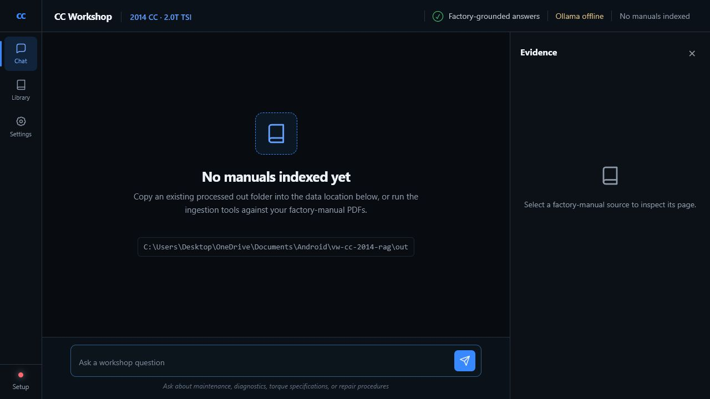
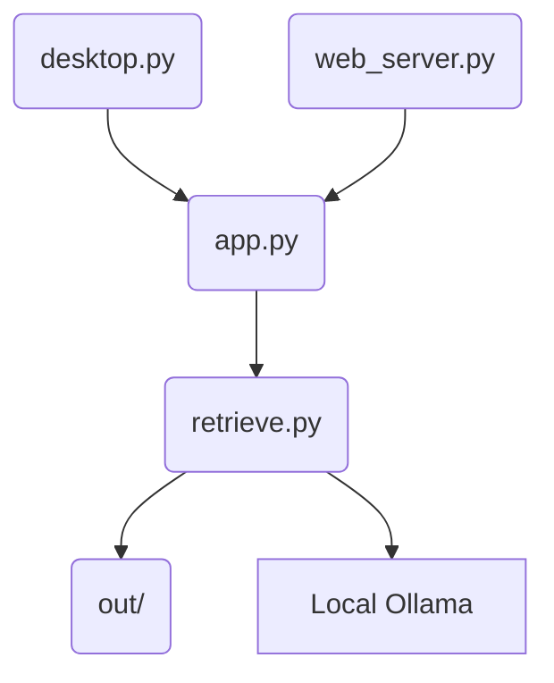

# CC Workshop

A manual-backed retrieval-augmented generation (RAG) tool serving as a native Windows desktop program and a responsive browser application for querying automotive factory manuals.




## Features

- Runs as a responsive browser application or a standalone Windows desktop program using the same Python backend.
- Ingests factory manual PDFs into a local vector database for querying via Ollama and Qwen3.6.
- Includes a safety-gated backend (`specverify.py`) to confirm critical values like torque.
- Provides a built-in local integrity reviewer (`manual_review.py`) to compare original manuals against processed text.
- Outputs a safety-separated Qdrant database, CSV, Parquet, Postgres DDL, and HEX analytics model via `build_vag_database.py`.

## Architecture



The desktop executable (`desktop.py`) and the web server (`web_server.py`) both communicate with the core backend (`app.py`). Generation and embedding are delegated to `retrieve.py`, which searches semantic chunks from the local `out/` database and requests grounded responses from the local Ollama instance.

## Quick start

**Prerequisites:** Python 3.11 and Ollama installed.

Pull the models:
```powershell
ollama pull qwen3.6:latest
ollama pull nomic-embed-text
```

Run the web application:
```powershell
.\run_web.ps1
```

Or build and run via Docker:
```powershell
docker compose up --build
```

Build the Windows desktop application:
```powershell
.\build_windows.ps1
```

For development tasks, including running safety checks:
```powershell
py -3.11 -m venv .venv
.\.venv\Scripts\python.exe -m pip install -r requirements-ingest.txt
.\.venv\Scripts\python.exe specverify.py selftest
.\.venv\Scripts\python.exe retrieve.py --selftest --embedder ollama
```

To build the Qdrant and HEX analytics database:
See [docs/VAG_DATABASE.md](docs/VAG_DATABASE.md) for build and upload commands.

To rebuild clean manuals:
```powershell
python rebuild_clean_manuals.py --source "C:\Users\Desktop\OneDrive\Documents\Official VW Manuuals" --output "C:\Users\Desktop\OneDrive\Documents\Projects\VW CC Clean Rebuilt v3" --force
```

To run manual review:
```powershell
python manual_review.py --rebuild-index
```

## Configuration

| Variable | Purpose | Default |
|----------|---------|---------|
| `VW_RAG_OUT` | Path to the processed manual index directory (`out` folder). | `out` (or `%LOCALAPPDATA%\CC Workshop\out` in desktop) |
| `OLLAMA_BASE` | URL for the local Ollama instance. | `http://localhost:11434` |
| `OLLAMA_MODEL` | Text generation model for Ollama. | `qwen3.6:latest` |
| `OLLAMA_EMBED_MODEL` | Embedding model for Ollama. | `nomic-embed-text` |
| `EMBEDDER` | Strategy used for embeddings. | `ollama` |
| `VW_VEHICLE_FILTER` | Enable or disable vehicle scope filtering. | `1` |
| `VW_VEHICLE` | Vehicle model to filter on. | `2014 VW CC 2.0T TSI` |
| `VW_ENGINE` | Engine code to filter on. | `CBFA` |
| `HOST` | Web server host binding address. | `0.0.0.0` |
| `PORT` | Web server port. | `5000` |
| `WEB_THREADS` | Number of threads for the Waitress web server. | `8` |

## Screenshots

<!-- SCREENSHOT PLACEHOLDER: hero image of the desktop interface -->
_Screenshot coming soon._

## Roadmap

- Diagnostic mode for reasoning over symptom retrieval.
- Environment and UI parity between web and desktop.

## License & credits

No license specified.

Based on the original VW CC 2014 manual-backed RAG project.

**Data and deployment warning:** Factory service PDFs and derivative indexes may be copyrighted. Keep deployments private or access-controlled, do not bake manuals into public images or installers, and retain the source PDFs as the canonical citation targets.
